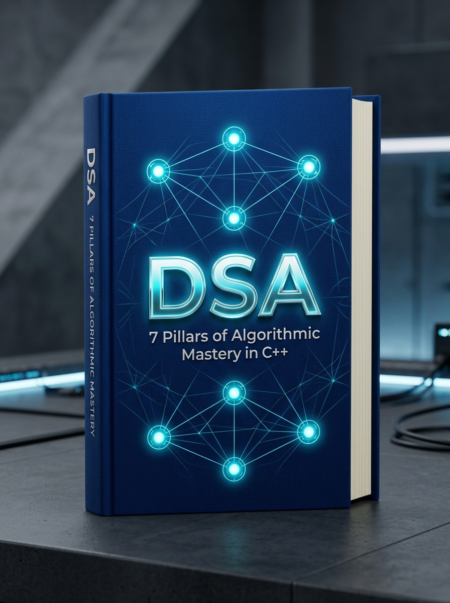

<div align="center">

# 📘 THE DSA BLUEPRINT
### 7 Pillars of Algorithmic Mastery in Modern C++
**A Strategic, Pattern-First Field Guide to Cracking Tier-1 & FAANG Technical Interviews**

[](https://kdp.amazon.com)
[](#)
[](#)
[-6366f1?style=for-the-badge)](#)
[](https://github.com/Vaibhavpandey8)

<br/>



<br/>

*"Memorization will fail you under pressure; pattern recognition never will."*

<br/>

[📖 Explore Chapters](#-the-7-pillars-architecture) •
[🎯 What Makes This Unique](#-what-makes-this-book-different) •
[⚡ Quick Sample](#-sample-cheat-sheet-preview) •
[👨‍💻 Author](#-about-the-author)

---

</div>

## 💡 Why This Book Exists

Most software engineering aspirants and college students get trapped in the **"500-Question LeetCode Grind"** without realizing that technical interviews do not test memory — they evaluate your ability to identify underlying data structure paradigms under strict 45-minute constraints.

**The DSA Blueprint** condenses hundreds of problems into **15 Core Algorithmic Patterns** written in idiomatic, high-performance **Modern C++ (C++17/C++20)**.

---

## 🚀 What Makes This Book Different?

| Feature | Typical Tutorial / Random Grind | The DSA Blueprint |
|---|---|---|
| **Approach** | Random problem solving (500+ questions) | **15 Core Reusable Mental Models** |
| **Language Standards** | Outdated C-style C++ (`printf`, raw pointers) | **Modern C++ (STL Mastery, Fast I/O, Lambdas)** |
| **Time Management** | No interview context | **The UMPIRE 45-Minute Interview Protocol** |
| **Decision Speed** | Guesswork during coding | **5-Minute Constraint-to-Algorithm Matrix** |
| **Edge-Case Safety** | Trial and error on submission | **Pre-Submission Edge Case Checklists** |

---

## 🏛️ The 7 Pillars Architecture

The book is structured into 7 foundational pillars covering 15 actionable modules:

```mermaid
graph TD
    A[The DSA Blueprint] --> P1[Pillar 1: Analytical Foundations]
    A --> P2[Pillar 2: Linear Stream Patterns]
    A --> P3[Pillar 3: Search & Monotonic Structures]
    A --> P4[Pillar 4: Pointer & Hierarchical Trees]
    A --> P5[Pillar 5: Priority & Graph Traversal]
    A --> P6[Pillar 6: Optimization & State Space]
    A --> P7[Pillar 7: Bitwise & Emergency Cheat Sheets]

    P1 --> M0[Module 00: 45-Min Mental Model & UMPIRE]
    P1 --> M1[Module 01: Constraint Matrix & STL Traps]
    P2 --> M2[Module 02: Two Pointers & Sliding Window]
    P2 --> M3[Module 03: Prefix Sums & Difference Arrays]
    P3 --> M4[Module 04: Binary Search on Answer Space]
    P3 --> M5[Module 05: Monotonic Stack & Deque]
    P4 --> M6[Module 06: Linked Lists Pointer Mechanics]
    P4 --> M7[Module 07: Binary Trees & BST Patterns]
    P5 --> M8[Module 08: Priority Queues & Top-K Heaps]
    P5 --> M9[Module 09: Graphs & DSU Connectivity]
    P5 --> M10[Module 10: Dijkstra & Shortest Paths]
    P6 --> M11[Module 11: Dynamic Programming - The Human Way]
    P6 --> M12[Module 12: Backtracking & State Pruning]
    P7 --> M13[Module 13: Bit Manipulation Hacks]
    P7 --> M14[Bonus: 48-Hour Emergency Tear-Sheet]
```



---

## 📚 Table of Contents & Chapter Guide

Click on any module to explore its focus:

<details open>
<summary><b>📂 Foundation & Interview Execution</b></summary>

* [x] **[Front Matter: About the Author & Edition](./00_About_The_Author.md)** — Publication details, license, and author note.
* [x] **[Table of Contents](./00_Table_Of_Contents.md)** — Architectural index.
* [x] **[Module 00: The 45-Minute Interview Mental Model](./00_Interview_Mental_Model.md)** — The UMPIRE framework, verbalizing thoughts, and debugging under pressure.
* [x] **[Module 01: Complexity Analysis & The Decision Matrix](./01_Complexity_and_Decision_Matrix.md)** — Deduce algorithms from constraints ($10^5 \implies O(N \log N)$), C++ STL pitfalls.

</details>

<details>
<summary><b>📂 Linear & Search Mastery</b></summary>

* [x] **[Module 02: Two Pointers & Sliding Window](./02_Two_Pointers_and_Sliding_Window.md)** — Opposite pointers, fast/slow cycle detection, fixed and variable sliding windows.
* [x] **[Module 03: Prefix Sums & Difference Arrays](./03_Prefix_Sum_and_Difference_Array.md)** — 1D/2D range query optimization in $O(1)$, prefix sum hash map tricks.
* [x] **[Module 04: Modified Binary Search](./04_Binary_Search_Patterns.md)** — Avoiding infinite loop bugs, search on answer space (Min of Max / Max of Min).
* [x] **[Module 05: Monotonic Stack & Deque](./05_Monotonic_Stack_and_Deque.md)** — Next greater element, largest rectangle in histogram, sliding window maximum in $O(N)$.

</details>

<details>
<summary><b>📂 Trees, Pointers & Graphs</b></summary>

* [x] **[Module 06: Linked Lists - Pointer Mechanics](./06_Linked_List_Patterns.md)** — Dummy heads, recursive/iterative in-place reversals, $K$-way merges.
* [x] **[Module 07: Binary Trees & BST Patterns](./07_Trees_and_BST.md)** — Top-down vs bottom-up recursion, LCA, diameter and boundary traversals.
* [x] **[Module 08: Priority Queues & Heaps](./08_Heap_and_TopK.md)** — Custom C++ functors, Top-$K$ elements, two-heap median streams.
* [x] **[Module 09: Graph Traversal & Connectivity](./09_Graph_Algorithms.md)** — Connected components, cycle detection, Kahn's topological sort, DSU with rank compression.
* [x] **[Module 10: Shortest Paths & MST](./10_Shortest_Paths.md)** — Dijkstra with `priority_queue`, Bellman-Ford, Kruskal's MST.

</details>

<details>
<summary><b>📂 Optimization, Bitwise & Emergency Sheets</b></summary>

* [x] **[Module 11: Dynamic Programming - The Human Way](./11_Dynamic_Programming.md)** — 1D, 0/1 Knapsack, LCS, LIS in $O(N \log N)$, space optimization techniques.
* [x] **[Module 12: Backtracking & State Space Search](./12_Backtracking.md)** — Subsets, permutations, combinations, branch pruning.
* [x] **[Module 13: Bit Manipulation Hacks](./13_Bit_Manipulation.md)** — Power of 2, `__builtin_popcount`, single number XOR variants.
* [x] **[Bonus: 48-Hour Emergency Cheat Sheet](./14_Emergency_Cheat_Sheet.md)** — Last-minute formula card and pre-submission checklist.

</details>

---

## ⚡ Sample: The 5-Minute Constraint Matrix

How to deduce your optimal target complexity before writing a single line of code:

| Input Constraint ($N$) | Allowed Time Complexity | Target Algorithmic Paradigm |
|---|---|---|
| $N \le 10$ to $12$ | $O(N!)$ or $O(N^2 \cdot 2^N)$ | Exhaustive Permutations, TSP, Bitmask DP |
| $N \le 20$ to $25$ | $O(2^N)$ | Backtracking, Recursive State Exploration |
| $N \le 500$ | $O(N^3)$ | Floyd-Warshall, 3D Dynamic Programming |
| $N \le 5,000$ | $O(N^2)$ | Nested Loops, 2D DP, Pair Matching |
| $N \le 10^5$ to $2 \times 10^5$ | $O(N \log N)$ or $O(N)$ | Sorting, Binary Search, Heaps, Two Pointers |
| $N \le 10^8$ to $10^9$ | $O(\log N)$ or $O(1)$ | Pure Binary Search, Math / Number Theory |

---

## 🛠️ Repository Structure

```text
├── 00_About_The_Author.md             # Author bio & publication metadata
├── 00_Table_Of_Contents.md            # Comprehensive module overview
├── 00_Interview_Mental_Model.md       # The UMPIRE Framework & scripts
├── 01_Complexity_and_Decision_Matrix.md
├── 02_Two_Pointers_and_Sliding_Window.md
├── 03_Prefix_Sum_and_Difference_Array.md
├── 04_Binary_Search_Patterns.md
├── 05_Monotonic_Stack_and_Deque.md
├── 06_Linked_List_Patterns.md
├── 07_Trees_and_BST.md
├── 08_Heap_and_TopK.md
├── 09_Graph_Algorithms.md
├── 10_Shortest_Paths.md
├── 11_Dynamic_Programming.md
├── 12_Backtracking.md
├── 13_Bit_Manipulation.md
├── 14_Emergency_Cheat_Sheet.md         # Final 48-hour cheat sheet
├── assets/
│   ├── book_cover_front.jpg           # High-resolution book cover
│   └── book_cover_fullpage.jpg
├── THE_DSA_BLUEPRINT_COMPLETE_BOOK.md # Complete unified manuscript
├── THE_DSA_BLUEPRINT_KINDLE.docx      # Production-grade Kindle format
└── README.md                          # Repository documentation
```

---

## 👨‍💻 About the Author

<table border="0">
  <tr>
    <td width="100" align="center">
      
    </td>
    <td>
      <b>Vaibhav Pandey</b><br/>
      Computer Science Engineer & AI/ML Researcher specializing in high-performance algorithms, system architecture, and algorithmic interview frameworks.<br/><br/>
      <a href="https://github.com/Vaibhavpandey8"></a>
    </td>
  </tr>
</table>

---

## 📜 Copyright & License

Copyright © 2026 by **Vaibhav Pandey**. All rights reserved.  
*Published via Amazon Kindle Direct Publishing (KDP).*  
This repository contains reference documentation and architectural outlines. All code snippets may be used for educational and personal interview preparation.

<div align="center">
  <b>⭐ If this cheatbook helps you crack an interview, please consider starring this repository! ⭐</b>
</div>
